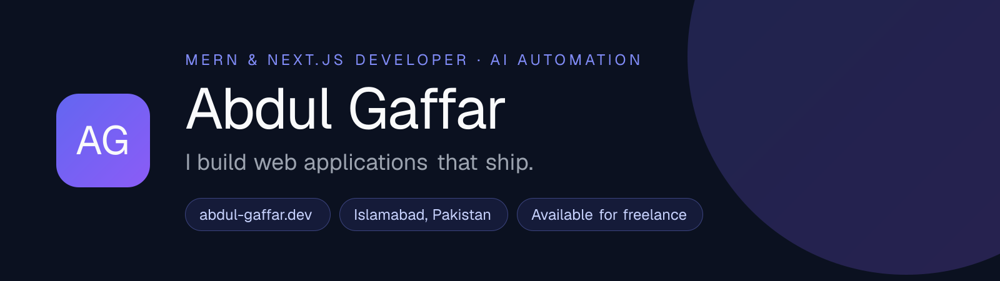

  

---

## 👋 About Me

I'm a full-stack developer from **Islamabad, Pakistan 🇵🇰** with **2+ years** of experience shipping production software with **React, Next.js, Node.js and MongoDB**. I turn complex requirements into fast, maintainable products, from multi-tenant SaaS platforms to internal dashboards, desktop apps and mobile apps.

- 🏢 **Alphinex Solutions:** building **StaffVertex**, a multi-tenant workforce management platform (web app + offline-first desktop tracker). I joined as a developer and now lead the team.
- 💼 **Freelance:** SaaS MVPs, admin dashboards, marketing sites and API integrations for clients, scoped and delivered end to end.
- 🤖 **AI automation:** wiring LLMs and workflow tools (OpenAI, n8n, Zapier, Make) into products so repetitive manual work runs itself.
- 🎓 **BS Software Engineering:** National University of Modern Languages (NUML), Islamabad.

---

## 🛠️ Tech Stack

**Frontend**
 

**Backend & Databases**
 

**Mobile & Desktop**
 

**AI & Automation**
 

**Tools & Cloud**
 

---

## 📂 Featured Projects

> **3,200+ contributions this year, mostly in private client and company repos.** That's why my public repos are few and older. Case studies for the work below are on [my portfolio](https://abdul-gaffar.dev/work).

<table>
<tr>
<td width="50%" valign="top">

### 🔧 StaffVertex: Web Platform
Enterprise SaaS · Workforce Management

Multi-tenant platform for workforce, time tracking and project management, with role-based access down to the feature level and real-time reporting.

`Next.js` `MongoDB` `Multi-tenant` `RBAC` `SWR`

</td>
<td width="50%" valign="top">

### ⏱️ StaffVertex: Desktop Tracker
Desktop App · Time Tracking

Offline-first desktop companion that records time and activity locally and syncs to the cloud when the connection returns, so no tracked time is lost.

`Tauri` `Rust` `React` `Offline-first` `Sync`

</td>
</tr>
<tr>
<td width="50%" valign="top">

### 🏥 Simple Green Solutions
Healthcare SaaS · Hospital Management

Cloud-based hospital management system connecting patients, hospitals and pharmacies: smart scheduling, unlimited EMRs, pharmacy ordering and full RBAC.

`Next.js` `Node.js` `MongoDB` `3-sided platform`

</td>
<td width="50%" valign="top">

### 🌾 Kisaan Hisaab
Mobile App · Farm Expense Management

Offline-first farm bookkeeping app for Pakistani farmers. Tracks field expenses and per-labour wages by season, with PDF reports in English, Urdu or Roman Urdu.

`React Native` `Expo` `SQLite` `PDF export`

</td>
</tr>
<tr>
<td width="50%" valign="top">

### 💊 Pharmacy Inventory System
Business Software · Inventory

Real-time stock control for pharmacies with batch and expiry tracking, low-stock alerts, supplier management and audit-ready reporting.

`Next.js` `MongoDB` `API Routes` `Zustand`

</td>
<td width="50%" valign="top">

### 🧾 Desktop POS System
Business Software · Point of Sale

Fast point-of-sale app for retail counters that runs fully offline: quick billing, returns, daily sales reports and role-based staff accounts.

`React` `Electron` `SQLite` `Node.js`

</td>
</tr>
</table>

---

## 📈 GitHub Activity

  <picture>
    <source media="(prefers-color-scheme: dark)" srcset="https://streak-stats.demolab.com?user=AbdulGaffarDev&theme=tokyonight&hide_border=true" />
    <source media="(prefers-color-scheme: light)" srcset="https://streak-stats.demolab.com?user=AbdulGaffarDev&theme=default&hide_border=true" />
    
  </picture>

---

## 📬 Let's Work Together

Need an MVP, a dashboard, an automation, or help rescuing an existing codebase? I reply within 12 hours.

  
  
  
  
  

**Thanks for visiting! 🚀**

